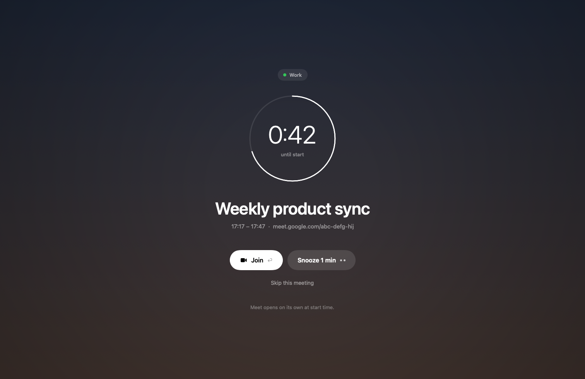

# RemindMeet

A macOS menu bar app for people who miss meetings despite calendar notifications.
One minute before each meeting, a full-screen panel covers everything: join, or snooze for a minute (twice at most).
"I won't join" sits at the bottom of the screen, away from the other buttons, so you can't hit it by accident.
If you haven't clicked by start time, it opens the Google Meet link itself and keeps the panel up until you do.

The menu bar icon lists today's meetings with their status.
Click one to preview its panel with the real countdown.
A preview changes nothing: only Join does something, and it opens the Meet link.

It reads events from the macOS Calendar, so add your Google account there. Build with `make run`, or `nix build`.
